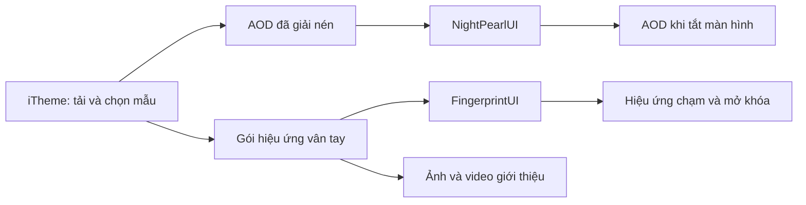

# Bắt đầu: bạn đang tùy biến phần nào?

[Mục lục](../README.md) · [Tiếp: kiểm tra thiết bị](02-thiet-bi-va-duong-dan.md)

## Hai công việc riêng

**AOD** là nội dung lúc màn hình ở chế độ hiển thị luôn bật: nhân vật, đồng hồ, ngày tháng, phần trăm pin. **Hiệu ứng vân tay** là hình động khi chạm/mở khóa. Icon vân tay đứng chờ lại là một phần khác; đổi hiệu ứng chạm không có nghĩa đổi luôn icon đó.

Trên máy đã nghiên cứu, iTheme quản lý tài nguyên tải về. NightPearlUI xử lý AOD; FingerprintUI xử lý phần giao diện vân tay. Ta chuẩn bị hình và cấu hình mà những bộ hiển thị này đã biết đọc, rồi thử thay đúng tài nguyên của một mẫu đang dùng được.

Sơ đồ mô tả vai trò. Nó không khẳng định mọi màn hình preview đều đọc cùng một tệp hay mọi máy đều có cùng luồng.

## Từ ngữ dùng trong tài liệu

| Từ | Hiểu đơn giản |
|---|---|
| Tài nguyên / asset | Ảnh, chuỗi ảnh, video hoặc cấu hình dùng để hiển thị |
| Frame | Một ảnh trong hoạt ảnh |
| Canvas | Tấm nền của một frame; có thể chứa nhiều vùng trong suốt |
| Viewport / vùng hiển thị | Phần màn hình bộ hiển thị dành cho nội dung; có thể nhỏ hơn canvas |
| Atlas | Nhiều hình được xếp chung vào một texture, có dữ liệu chỉ vị trí/cách cắt |
| Payload | Phần tài nguyên thực dùng để vẽ, như `content/animation.zip` |
| Metadata của gói | Tên, ID, phiên bản, các thông tin mô tả và tham chiếu |
| Metadata của tệp | Chủ sở hữu, nhóm, quyền truy cập, nhãn SELinux; khác metadata của gói |
| Hash SHA-256 | Dấu nhận dạng của nội dung tệp; hai bản giống từng byte có cùng hash |
| Root tạm thời | Quyền root có thể mất, nhất là sau khởi động lại; dữ liệu đã sửa không tự quay về |

## Cách làm lần đầu

1. Chọn **một** AOD hoặc hiệu ứng đã tải hợp lệ và chạy được từ iTheme/Cài đặt.
2. Đọc đường dẫn thực, phiên bản bộ hiển thị và danh sách tệp trên máy mình.
3. Sao lưu bản đang chạy cùng metadata tệp; kiểm tra có thể đọc lại bản sao.
4. Sửa trên **bản làm việc ở thư mục riêng**. Lần đầu chỉ đổi một yếu tố dễ nhận ra.
5. Kiểm tra cấu trúc, ảnh và tên tham chiếu trước khi đưa vào máy.
6. Áp dụng theo [quy trình](08-ap-dung-va-khoi-phuc.md), kiểm tra preview rồi thử trạng thái thực.
7. Ghi kết quả và thử khôi phục trước khi tăng quy mô.

Ví dụ: với FP, thử chuỗi PNG gốc không dùng atlas trước; sau đó mới đổi vài frame. Với AOD, giữ tên/số frame/kích thước để xác nhận thay hình, rồi mới thử bố cục. Việc này giúp tìm nguyên nhân nếu bản sửa không hiển thị.

## Thế nào là “cài từ bên ngoài” trong nghiên cứu này?

Đã có kết quả với **tài nguyên tự làm được đưa vào một gói/mẫu đã có trên máy**. Chưa chứng minh có API nhập mọi ITZ mới, đăng ký một ID mới hoặc nhập ZIP bất kỳ để nó tự xuất hiện trong danh sách iTheme.

Mẫu tải hợp lệ cung cấp cấu trúc và điểm tham chiếu mà hệ thống đang sử dụng. Việc thay tài nguyên tại đó không chứng minh đã tạo được chữ ký, giấy phép hoặc cơ chế đăng ký theme mới. Giữ nguyên các tệp/giá trị liên quan xác thực, tài khoản và giao dịch.

## Cách đọc mức xác nhận

- **Tệp:** đọc trực tiếp cấu trúc và nội dung mẫu.
- **Mã:** tìm được đường xử lý trong phiên bản APK/thư viện cụ thể.
- **Máy:** có log, hash hoặc phản hồi thử nghiệm trên thiết bị.
- **Chưa rõ:** chưa đủ dữ liệu; không đưa thành tính năng bảo đảm.

“Có trong mã” chưa đồng nghĩa “đã thử đủ trên máy”. “Chủ máy thấy chạy” chưa đồng nghĩa đã đo hiệu năng hay áp dụng được trên mọi bản ROM.
