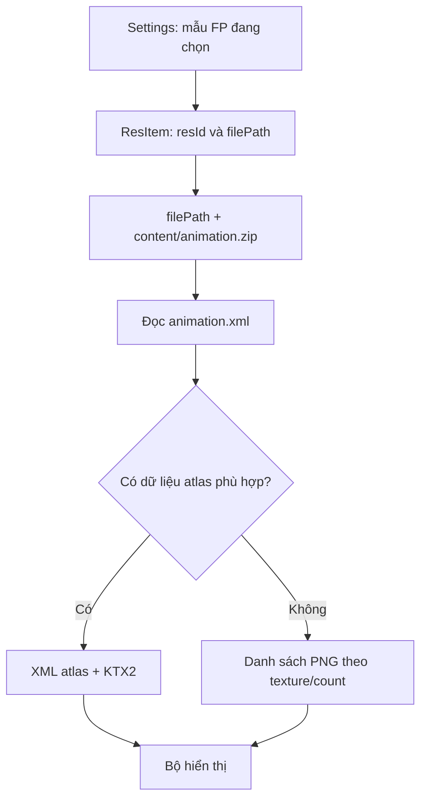

# Hiệu ứng vân tay: gói tải về được đọc như thế nào?

[Mục lục](../README.md) · [Tiếp: tùy biến hiệu ứng](06-fingerprint-tuy-bien.md)

## Thư mục của mẫu đã nghiên cứu

Mẫu `进化` (Evolution), `resId=2003000011`, nằm trong nhóm tài nguyên `103`. Listing trên máy xác nhận:

```text
/data/bbkcore/bbkthemeres/novoland/103/进化/
├── description.xml             759 byte
├── key                         186 byte
├── content/
│   └── animation.zip        761220 byte
├── preview/
│   ├── preview_0.mp4          69873 byte
│   └── preview_0_ff.jpg       32793 byte
└── thumb/
    └── thumb_0.jpg            7800 byte
```

Đây là kích thước **bản gốc tại thời điểm listing**, không phải mức bắt buộc cho bản sửa. Tên preview trên URL metadata có thể khác phần mở rộng của tệp cục bộ; mẫu này có URL `.webp` nhưng listing cục bộ là `.jpg`. Phải kiểm tra tệp thực, không suy tên đích từ URL.

`description.xml` có `id=1107432`, `uid=2003000011`, edition 2 và `verify_file/vf_file` chỉ tới `content/animation.zip`. Chưa xác minh đầy đủ enforcement của trường này ở mọi thành phần. Không sửa `key`, ID hoặc dữ liệu xác thực để thử hình.

## Bên trong animation.zip

```text
animation.zip
├── animation.xml
└── evolution/
    ├── evolution.xml
    ├── evolution.ktx2
    └── evolution_1.png … evolution_26.png
```

[Cây đầy đủ và kích thước entry](../evidence/fp-animation-tree.txt). XML của bản gốc:

```xml
<animation type="18" name="evolution"
    atlasData="evolution/evolution.xml"
    atlasTexture="evolution/evolution.ktx2"
    texture="evolution/evolution_{n}.png"
    count="26" duration="32" height="600" width="600"/>
```

Có **hai bộ tài nguyên cùng tồn tại**: atlas XML/KTX2 và 26 PNG rời. PNG gốc là ảnh indexed/palette có transparency, 600 × 600. KTX2 là texture atlas 2005 × 924; kích thước atlas không phải kích thước mỗi frame trên màn hình.

Atlas XML mô tả cách lấy từng phần từ texture, có thông tin hình học. Thay texture nhưng giữ dữ liệu cắt/mesh không phù hợp có thể làm méo hoặc mất phần ảnh. Đổi đuôi PNG thành `.ktx2` không tạo texture KTX2.

## Luồng nạp đã lần theo



Trong FingerprintUI đã phân tích, `h2.j.S0` lấy JSON của `udfp_unlock_res_effect_style`, đọc `ResItem`, nối `filePath` với `content/animation.zip`. `a2.b0.p` đọc cấu hình gói iTheme; `h2.z0.J` chọn atlas hoặc PNG. Các nhánh tương tự còn có ở những trạng thái khác.

Java nối xuống thư viện `libvkrenderer.so` qua `nativeSetAnimation` hoặc `nativeSetAtlasAnimation`. Native có bộ phát frame, atlas, bộ đọc PNG palette và texture KTX. Việc thư viện có Vulkan không chứng minh mọi trạng thái luôn dùng cùng backend.

Với mẫu có atlas hợp lệ, thay PNG riêng có thể không đổi hình đang thấy. Phép thử bỏ khai báo atlas, giữ ảnh PNG gốc, rồi thêm dấu caro trong vài PNG đã được thực hiện. Chủ máy thấy dấu nhận diện; log kiểm tra ghi payload đã thay và khôi phục. Phản hồi dấu caro không chỉ rõ preview, mở khóa thật hay cả hai, nên không gán thêm phạm vi cho nó.

## Ý nghĩa các trường

| Trường | Ý nghĩa trong nhánh gói tải ngoài đã đọc |
|---|---|
| `name` | Tên hoạt ảnh trong cấu hình |
| `texture` | Mẫu tên PNG; `{n}` được dùng để tạo tên frame |
| `count` | Số frame; mẫu này đánh số từ 1 |
| `duration` | Khoảng danh nghĩa mỗi frame, đơn vị ms trong đường đã lần theo |
| `width`, `height` | Kích thước hoạt ảnh được parser đọc; còn phụ thuộc bố trí/renderer |
| `atlasData`, `atlasTexture` | Khai báo bộ atlas; cả hai phải có dữ liệu phù hợp |
| `atlasFrameDuration` | Có đường override dương cho atlas; chưa có thử nghiệm tùy biến đầy đủ |
| `type="18"` | Có trong mẫu, nhưng parser gói iTheme `a2.b0.p` không đọc nó |

Parser gói tích hợp khác có đọc `type`, `button`, `reverse`, `thumbnail`. Không lấy các trường của parser đó để tuyên bố mẫu tải ngoài cũng hỗ trợ. Giữ trường của mẫu nếu chưa cần đổi; `18` không phải bằng chứng về FPS hay mã bật một backend.

`duration=32` nghĩa là khoảng 32 ms, tương ứng 31,25 frame/giây danh nghĩa. 26 × 32 = 832 ms là ngân sách thời gian danh nghĩa, không phải số đo thực trên điện thoại. Native có lập lịch/bù thời gian; thời điểm dừng còn phụ thuộc lifecycle.

## Icon chờ và dữ liệu sinh trắc học

Các khóa icon như `fingerprint_icon_style_resource` có đường xử lý riêng. Ít nhất một nhánh tra tên drawable trong resource `vivo`, không mở một PNG bất kỳ trên `/sdcard` chỉ vì gán đường vào settings. Chưa có phương pháp tùy biến mọi icon chờ được xác nhận ở đây.

Nghiên cứu này thay tài nguyên hình động. Không đổi dữ liệu đăng ký vân tay, vùng nhận chạm, tọa độ/độ sáng quét, dịch vụ xác thực hoặc thư viện hệ thống. Việc hình động đặt lệch không có nghĩa cảm biến đã di chuyển.

Nguồn: [F01–F05 và C02–C03](11-bang-chung.md), [bản đồ đường mã](../evidence/code-map.md).
