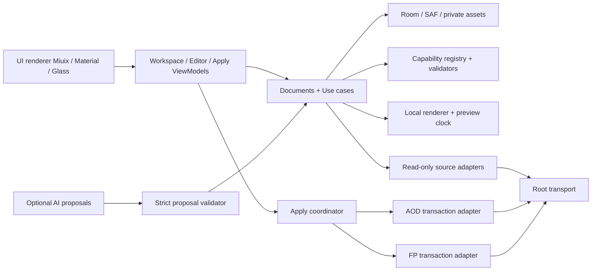

# Kiến trúc viết lại theo tài liệu và năng lực

## Phân lớp

Giữ Kotlin/Compose/MVVM/Hilt/Flow/Room/DataStore/SAF. Bảy module đang build được vẫn là điểm xuất phát; không xóa parser/root/transaction đã có test chỉ để tạo lại thư mục rỗng. Tách thêm module khi có code/quan hệ dependency thật, không tạo hàng chục module trống.

UI/AI/parser không giữ tham chiếu RootManager. Chỉ source adapter và apply coordinator có transport root. AI không có route gọi apply, shell, settings hoặc cài APK. Nút UI gọi use case; mọi điều kiện kiểm lại trong engine.

## Mô hình cần triển khai tiếp

`SourceSnapshot`: opaqueId, kind, contentHash, observedProfile, immutable private files, capture time, integrity evidence. Metadata download/source names không là proof sở hữu hay root permission.

`AodDocument`: version, snapshotRef, pattern, branches1080/1440, raw config với unknown fields, typed supported patches, glyph slots, static decoration, sequence timing/lastImage. Giữ chuỗi JSON của mẫu khi exporter cần string, không chuyển cả cây sang float rồi mất trường. Root canvas/viewport/display/canvas ảnh là bốn khái niệm riêng.

`FingerprintDocument`: canvas, artworkAnchor, frame timeline, crop/fit mode, transforms/keyframes/layers, outputProfile. `SensorCalibration` là dữ liệu hiệu chỉnh riêng của OTE, đọc hoặc user-calibrate; không áp ngược vào hệ thống.

`CapabilitySet`: parserId/version, supported edit fields, render codec, output constraints, read support, preview fidelity, apply support, evidence IDs. Các capability là dữ liệu trong ứng dụng được review, không do pack hay AI tự cấp.

`ApplyPlan`: project revision + source hash + expected target identity + payload hash + affected files + snapshot estimate + reload instructions. Một thay đổi draft/source/root/profile làm plan cũ hết hiệu lực. Plan review không phải “token vượt kiểm tra”; confirm vẫn revalidate.

`ApplyOutcome`: FILES_VERIFIED / RELOAD_REQUIRED / RUNTIME_CONFIRMED_BY_USER / ROLLED_BACK / UNCERTAIN. Không collapse về Boolean success.

Hiện baseline có `ThemeManifest` thiên về frame pack, không đủ đại diện AOD có clock. Vì vậy chưa nhập nativeITZ thành “dự án AOD đầy đủ”; AssetImporter mới trích frame để preview. Không được mất raw source khi xây document adapter mới.

## Giao dịch

1. Người dùng chọn tác phẩm và mẫu nền hợp lệ.
2. Đọc profile/UID0/owner/mode/context/hash, kiểm source/app/build hỗ trợ.
3. Compile payload offline vào private staging, kiểm giới hạn+checksum.
4. Bảng áp dụng hiển thị diff/đích/snapshot/các bước hệ thống.
5. Khi confirm, lặp các kiểm quan trọng và chống source đổi giữa chừng.
6. Tạo snapshot đã kiểm nội dung và metadata, journal durable trước mutation.
7. Ghi trong allowlist adapter, kiểm từng bước và postcheck.
8. Nếu thất bại rõ ràng và còn quyền: rollback đúng snapshot. Nếu timeout/root mất: UNCERTAIN, giữ journal; không tự retry/kill/reboot/cleanup mù.
9. Người dùng reload qua giao diện đã biết rồi xác nhận nhìn thấy; số đo pin/RAM/FPS là bước riêng.

AOD nhiều file cần journal có danh sách created/replaced, restore cả file thêm, khóa đơn tác vụ và cơ chế renderer không quan sát nửa bộ mới/cũ. Không bê single-ZIP FP transaction sang AOD bằng đổi chuỗi path. Nếu không chứng minh atomic group/reload an toàn thì adapter AOD tiếp tục unavailable.

Các thư mục root-private stage/lock và dữ liệu riêng OTE có ghi `/data`; nói rõ điều đó. Không ghi block device, phân vùng boot/system/vendor/vbmeta hay APK. Mất temp root có thể cản rollback tức thì: trạng thái phải thành thật, phương án đổi mẫu qua UI cần được thử trước.

## Di trú dữ liệu

Giữ applicationId nếu giữ được signing identity. Room cần migration rõ ràng trước khi tách `ThemeItem` thành SourceSnapshot/Project/Export; không destructive fallback. Nhập frame packs hiện tại thành project-image có nguồn legacy, không đoán clock hay sensor anchor. API keys loại khỏi backup/export/diagnostics; export project dùng asset ID tương đối trong ZIP, chống traversal/symlink.

Editor thao tác qua command stack; autosave atomic; re-open/process death/rotation/locale/theme giữ revision. Export là job cancelable có progress/budget; chỉ đưa kết quả vào library sau validate và atomic promote. Navigation state không thay thế persistence dự án.
