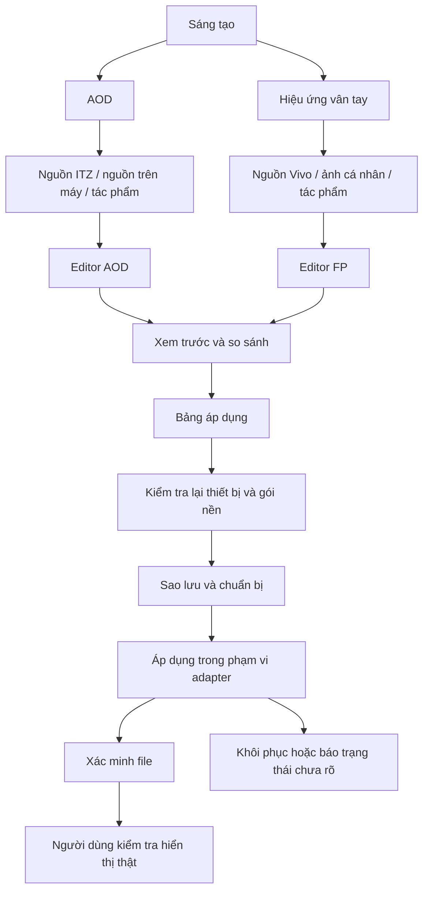

# Thiết kế sản phẩm OTE

## Mục đích

Người dùng bắt đầu bằng câu “tôi muốn làm AOD” hoặc “tôi muốn làm hiệu ứng vân tay”, không phải “tôi cần chạy lệnh root”. OTE dẫn họ qua chọn nguồn, chỉnh, xem trước, kiểm tra và áp dụng. SukiSU chỉ cung cấp cảm hứng UI; không có trang module, flash, kernel tuning, quản lý SU của app khác hoặc tính năng nâng quyền.

FG trong trao đổi được hiểu là fingerprint effect, viết tắt kỹ thuật thống nhất là FP. Đây chỉ là hình ảnh khi mở khóa, không phải dữ liệu vân tay hay cơ chế nhận diện.

## Bố cục

Thanh điều hướng có bốn mục: **Sáng tạo — Áp dụng — Thiết bị — Cài đặt**. Trang Sáng tạo có hai thẻ AOD và Hiệu ứng vân tay. Khi vào một thẻ, tiêu đề, thư viện, nguồn gốc, timeline và xuất file đều giữ cùng loại. Studio không còn là màn hình chung mặc định tạo FP khi đang làm AOD.

| Thành phần | AOD | Hiệu ứng vân tay |
| --- | --- | --- |
| Nguồn trên máy | ITZ đã tải / snapshot AOD đang dùng | Các gói FP Vivo đã tải |
| Nguồn cá nhân | ITZ, GIF, PNG, otepacks | PNG, GIF, native animation ZIP, otepacks |
| Tài liệu chỉnh sửa đích | Cấu hình gốc + nhánh độ phân giải + lớp ảnh + glyph đồng hồ + ngày/thứ + vị trí pin | Canvas artwork + timeline + layer + anchor của artwork; tách tọa độ cảm biến |
| Xem trước | Mô phỏng giờ/ngày/pin, khung viewport theo profile, ảnh cuối; có nhãn mô phỏng | Vòng trước/nhấn/kết thúc nếu profile có; tâm artwork và tâm cảm biến khác nhau |
| Xuất | Draft project / assets / ITZ khi round-trip và parser đã xác minh | Draft project / PNG RGBA / native ZIP theo profile |
| Áp dụng | Adapter AOD có snapshot nhiều file, chưa hoàn thiện | Adapter FP cố định đã có source; còn cần thử từ APK |

## Luồng màn hình đích

## Bảng áp dụng

Hiển thị loại tác phẩm, preview, gói nền thực tế, khác biệt sẽ ghi, kiểm tra còn thiếu, snapshot và hành động tiếp theo. “Đã kiểm tra file”, “Đã ghi file” và “Đã xem chạy trên máy” là ba trạng thái khác nhau. Không hiển thị “thành công hoàn toàn” chỉ vì lệnh kết thúc với mã 0.

Không gọi gói Vivo là “quyền để lách”. Nó là tài nguyên người dùng đã tải hợp lệ và profile mà renderer đã biết. Metadata tải xuống/ID/quyền sở hữu không được sửa để ép xác thực. Nếu iTheme từ chối gói tự tạo, hiển thị lý do và giữ luồng chỉnh bản sao/đã triển khai có kiểm chứng.

## Hướng dẫn lần đầu, ngắn và có hình minh họa

AOD: (1) Tải và thử một AOD iTheme. (2) Chọn mẫu ITZ hoặc quét nguồn. (3) Tạo bản sao để chỉnh. (4) Xem đồng hồ ở 00:00, 11:11, 23:59 và nội dung cuối. (5) Chỉ mở Apply khi adapter đầy đủ.

FP: (1) Tải và thử mẫu Vivo. (2) OTE kiểm tra mẫu nào đã hỗ trợ. (3) Nhập hoạt ảnh; chỉnh kích thước và tâm artwork. (4) Chọn Không có trong giao diện hệ thống trước khi thay tài nguyên. (5) OTE sao lưu/ghi/xác minh; người dùng chọn lại mẫu nền và xem preview. Các bước này không hướng dẫn can thiệp xác thực sinh trắc học.

Hướng dẫn dùng hình/vector tự tạo, chữ ngắn, nút “Đã hiểu”; luôn mở lại được trong Thiết bị. Nội dung vẫn có giá trị khi chưa root. App không xin SU ngay khi mở.

## UI và tính liên tục

Dùng một hệ thống điều hướng/dữ liệu cho cả ba phong cách. Miuix: nhóm cài đặt, card lớn, bo liên tục và phản hồi chạm. Material: tokens M3 và dynamic color. Glass: nền lấy mẫu + lớp hiệu ứng có giới hạn; giảm trong lúc kéo timeline/chạy preview, chế độ giảm hiệu ứng và giảm trong suốt. Không sao chép màn hình quản lý root của SukiSU.

Tách “dự án đang chỉnh” khỏi “gói đã xuất”; autosave, undo/redo, nút hiện phần chưa lưu, mở lại chính xác tác phẩm. Khi đổi phong cách/ngôn ngữ hoặc process death không được mất draft. Đây là tiêu chí nghiệm thu, không phải các tính năng đã hoàn tất ở nhánh bàn giao.

## Đề xuất có ích

| Tính năng | Khả thi / ưu tiên | Phạm vi rủi ro |
| --- | --- | --- |
| Preview trước/sau kéo thanh so sánh | Cao / P1 | Chỉ đọc, đo RAM |
| Favorites và collection theo nhân vật | Cao / P2 | Database riêng |
| Autosave dự án | Cao / P1 | Atomic write riêng app |
| Undo/redo lệnh chỉnh | Cao / P1 | Giới hạn bộ nhớ |
| Bản sao mẫu bất biến | Cao / P1 | Không ghi nguồn gốc |
| Quét năng lực theo từng gói | Trung bình / P1 | Không suy từ ID/filename |
| Xem diff tài nguyên trước Apply | Cao / P1 | Không lộ key/metadata xác thực |
| Điểm khôi phục có nhãn gốc/mod | Cao / P1 | Kiểm checksum, không gọi mod là factory |
| Rounded mask không cắt nội dung | Cao / P2 | Fit toàn ảnh trước mask; preview alpha |
| Đồng hồ thử nhiều mốc giờ | Cao / P1 | Mô phỏng, không sửa giờ hệ thống |
| Hiệu chỉnh tâm bằng lưới | Cao / P2 | Lưu riêng app, không sửa sensor config |
| Ước lượng pixel/frame/RAM | Cao / P1 | Ước lượng, không cam kết pin |
| Phát hiện frame trùng | Cao / P2 | Bảo toàn tổng duration |
| Nén PNG lossless | Cao / P2 | So hash pixel, không chỉ file nhỏ |
| Batch import có tổng ngân sách | Cao / P2 | Chặn ZIP bomb/traversal |
| Xuất profile chẩn đoán đã lọc | Cao / P1 | Không có token/serial/tài khoản |
| Profile theo sở thích | Cao / P2 | Chỉ chọn draft, không tự ghi lúc boot |
| AI gợi ý scene có quy tắc | Trung bình / P3 | Không có quyền gọi root |
| Community repo | Sau này / P4 | Chữ ký pack, kiểm tra nội dung, không script |
